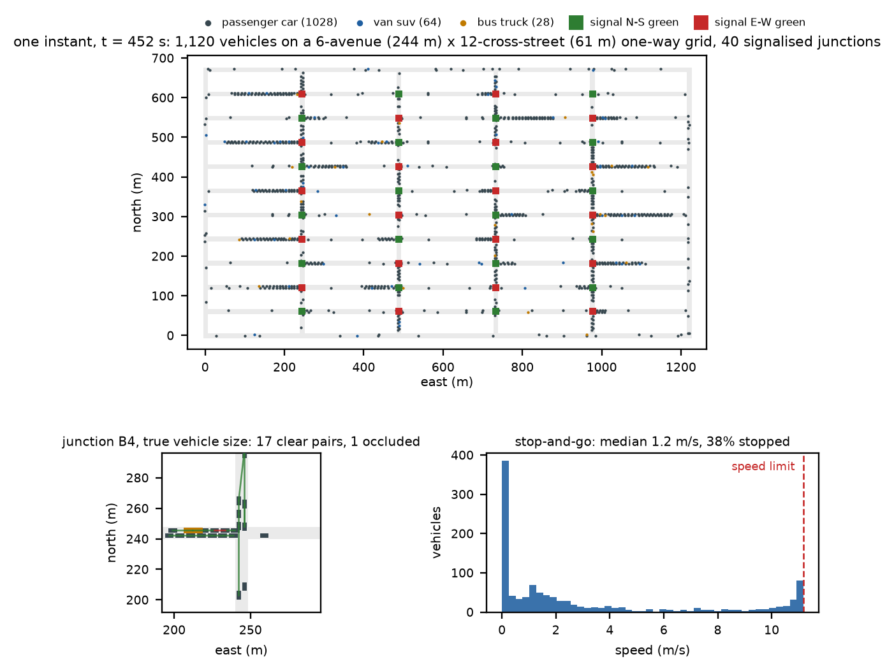

# GRAIL-V

A geometry-consistent feasibility study of hybrid **NR sidelink + vehicular
visible light** communication for the 3GPP TR 38.913 eV2X reference row, on a
microscopic Manhattan-grid V2V mobility model.

Both channels are evaluated against the same vehicle geometry, so an optical
path and a radio path for the same packet see the same world. What a
transmitter is allowed to *observe* is kept separate from what the channel
actually does: decisions read noisy, aged tracks, while every reported number
comes from the realized outcome.

## The result

Measured over 20.9 M packets across three densities, 20 000-replicate
trajectory-block bootstrap, four RF attempts per packet:

| ρ (veh/lane·km) | pool claim | radio alone | light alone | duplicate all | **allocated** |
|---|---|---|---|---|---|
| 10 | 0.48 → 0.41 | **2.240e-06** ✓ | 5.384e-01 | 1.282e-06 (cost 2.0) | 1.028e-06 (cost 1.0) |
| 20 | 1.07 → 0.67 | 1.466e-05 ✗ | 3.440e-01 | 4.753e-06 (cost 2.0) | **1.329e-06** ✓ (cost 1.0) |
| 30 | 1.62 → 0.78 | 4.545e-05 ✗ | 2.259e-01 | 8.991e-06 (cost 2.0) | **1.084e-06** ✓ (cost 1.0) |

Three claims follow, and the third is the contribution.

**The binding constraint is the resource pool, not the link budget.** Mode-2
supplies 2 subchannels × 200 slots = **400 (subchannel, slot) resources** per
100 ms generation period, and every vehicle draws from the same one.
Reliability is bought with retransmissions, so *n* vehicles each claiming *N*
attempts need `n·N ≤ 400`. At ρ = 30 the profile asks for 1.62× what exists.
The radio does not fail because it is weak; it fails because it cannot buy the
attempts.

**Neither medium alone meets 10⁻⁵ above ρ ≈ 17–18.** The radio clears the
budget by five orders at ρ = 10 and misses at both denser conditions. The
optical link misses everywhere, on a 22–54 % geometric outage that no transmit
power reaches.

**The second medium earns its place by relieving the pool, not by adding
diversity.** Duplicating every packet costs 2.0 activations and is 8× *worse*
than allocating at ρ = 30, because a duplicated packet still spends the radio
resource that was scarce. Carrying the short-clear-path packets by light alone
returns their share: demand falls 1.62 → 0.78 and the radio can afford the
attempts after all.

### What is a bound rather than a policy

The allocation chooses offload targets on the packet's *true* optical risk. No
vehicle knows that number, so the table above is an upper bound on what a
load-aware allocation achieves, not an achievable operating point.

A selector using only observables — `separation < 9.5 m ∧ FOV margin > 0.9`,
both computable from cooperative awareness messages — reaches 99.94 %
precision against a 99.998 % requirement. Giving offload candidates light *plus
two RF attempts* instead of none covers that error and **is realizable at
ρ = 20**: 7.00e-06 at pool claim 0.89, activation cost 1.34. At ρ = 30 no
selector realizes it, and the obstacle is optical *coverage* — 52 % of packets
have no usable optical path and must be carried by radio — rather than
selector accuracy.

## Method

The allocation and the channel determine each other: a packet carried by light
returns its share of the pool, so the contention the remaining radio packets
face is a consequence of how many left. That circularity is solved as a
damped fixed point, swept from several starting loads because the map has more
than one — started congested, duplication looks necessary and duplicating keeps
it congested.

Fixed-point analysis of C-V2X contention is not new (Wang *et al.*, VTC 2018,
solve one in collision probability at fixed load); the fixed point here is in
the *allocation*, i.e. how much load leaves the radio entirely.

## Scenario

- One-way Manhattan grid: 6 avenues at 244 m, 12 cross streets at 61 m, 2 lanes
  per direction, 40 signalised junctions on a 45 s fixed two-phase cycle
- Densities 10 / 20 / 30 veh/lane·km; 50 ms mobility step; 11.18 m/s limit
- 90 % passenger car, 7 % van/SUV, 3 % bus/truck, at their configured body
  dimensions — an 11 m truck occludes far more optical path than its share
  suggests
- Signalised stop-and-go: median 1.2 m/s with ~38 % of vehicles stopped, which
  is why clear optical paths persist for 3–16 s



## Service profiles

| | headline | eV2X row |
|---|---|---|
| payload | 300 B | 300 B |
| period | 100 ms | 100 ms |
| deadline | 3 ms | 3 ms |
| miss budget | 10⁻⁴ | **10⁻⁵** |
| RF attempts | 3 | 4 |
| VLC attempts | 1 | 1 |

Payload and deadline follow the TR 38.913 eV2X reference row. The 10⁻⁴ budget
follows the 99.99 % class of TS 22.186; the 10⁻⁵ profile takes the eV2X row's
own target. Actions are RF, VLC, or simultaneous DUP at normalized activation
costs 1, 1 and 2. No feedback HARQ inside the deadline. The complete tuple is a
controlled research profile, not a conformance claim.

## Reproducing

Python 3.11 or 3.12.

```bash
python -m pip install -e '.[dev]'
grailv doctor
pytest
```

Traces are large and not in the repository. To regenerate and evaluate:

```bash
python scripts/generate_synthetic_traces.py
python scripts/build_training_cache.py
python scripts/run_evaluation.py --packets 10000000 --replicates 3 \
    --densities 10 20 30 --pattern-variant wide --bootstrap 20000 \
    --config configs/project/default.yaml \
             configs/mobility/synthetic_manhattan.yaml \
             configs/service/ev2x_300B_3ms_1e-5.yaml \
             configs/channel/rf_nr_v2x.yaml configs/channel/vlc_vehicle.yaml \
             configs/observation/causal_200ms_forecast.yaml \
             configs/training/primal_dual_ppo.yaml \
             configs/training/primal_dual_ppo_ultra.yaml \
             configs/evaluation/ultra_reliability.yaml
python scripts/build_figures.py --budget 1e-5 \
    --campaign artifacts/evaluations/campaign-test-ev2x-300B-3ms-1e-5-wide-10000000.json
```

The evaluation writes each density as it completes and merges with any already
in the artifact, so a campaign can be finished in more than one sitting. It
refuses to merge runs whose seed, budget, bootstrap count or config hash
differ.

`configs/training/` is retained as **provenance, not machinery**. Nothing
trains: `HASH_SCOPES` places `training` inside the mobility scope deliberately,
so removing the layer would change the digest stamped on every trace manifest
and on the campaign artifact.

## Layout

```
src/grail_v/
  mobility/      Manhattan-grid generator: car-following, signals, tagged pairs
  channels/rf/   NR-V2X: 37.885 path loss, fading, shadowing, BLER, collision
  channels/vlc/  R112 headlamp pattern, OOK, optical gain, receiver, noise
  geometry/      vehicle and building occlusion, RF visibility
  observation/   noisy tracks, forecasting, link state — what a vehicle can see
  env/           packet lifecycle, rollout, campaign, allocation, statistics
  config/        layered YAML, validation, scoped hashing
scripts/         trace generation, caching, evaluation, figures
artifacts/       generated outputs with manifests; not source
research/        literature reviews and parameter provenance
```

Every generated artifact carries a manifest recording the code commit, config
hash, random seeds, library versions and a SHA-256 per file.

## Status and history

The current plan is [`PLAN.md`](PLAN.md).

Earlier planning documents are retained unchanged for provenance and describe a
programme this repository no longer runs — a PPO/primal-dual learned policy,
one RF attempt, densities 20/40/60, and a single-lane grid. Read them as
history, not as specification:
[`GRAIL_V_WORK_PLAN_V3.md`](GRAIL_V_WORK_PLAN_V3.md),
[`GRAIL_V_WORK_PLAN_V2.md`](GRAIL_V_WORK_PLAN_V2.md),
[`CODE_IMPLEMENTATION_SPEC.md`](CODE_IMPLEMENTATION_SPEC.md),
[`EXECUTION_PLAN_V2_1.md`](EXECUTION_PLAN_V2_1.md),
[`research/HYPOTHESES.md`](research/HYPOTHESES.md).

The PPO era is preserved in full on `baseline/3ms-1e-4-primal-dual-ppo`; the
SUMO/TraCI mobility implementation on the `baseline/*_SUMO-TraCI` branches, in
the [`Manhattan-Grid_Synthetic_V2V`](https://github.com/easha003/Manhattan-Grid_Synthetic_V2V)
repository.

The Gate-0 comparison in [`paper/U0_OVERLAP_MATRIX.md`](paper/U0_OVERLAP_MATRIX.md)
remains provisional until the authors compare the exact U0 manuscript and check
the target venue's related-submission policy.
